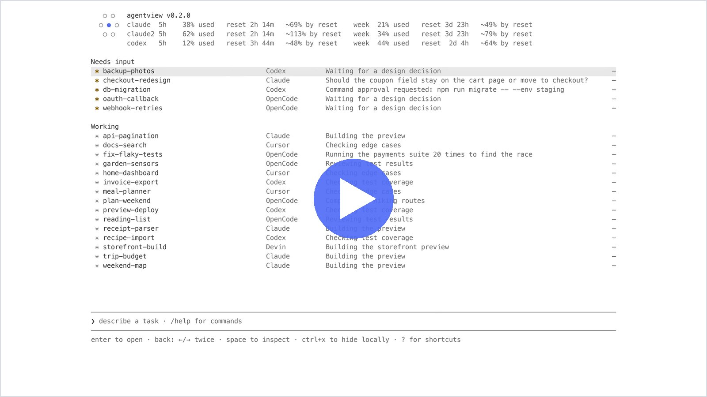
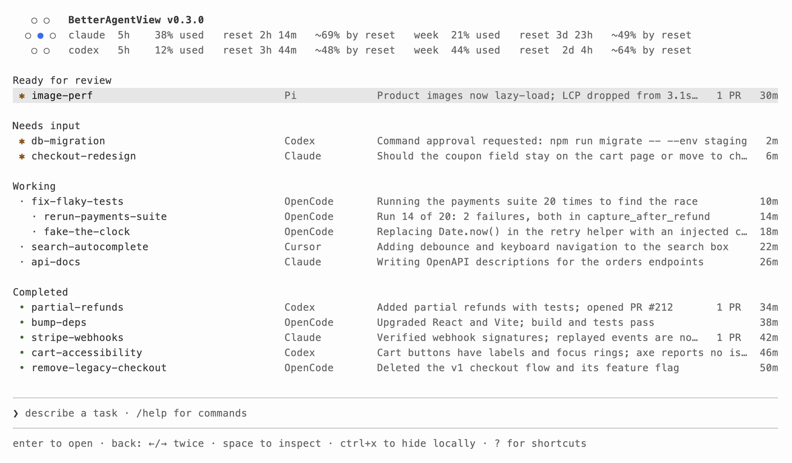

<div align="center">

<h1> BetterAgentView</h1>

**All your coding agents. One terminal.**<br>
See which one needs you. Jump in, jump back out. Works with 18 coding
harnesses and plain shell jobs.

[](docs/testing.md)
[](https://github.com/moritzWa/betteragentview/releases/latest)
[](LICENSE)

<a href="https://betteragentview.com/film.mp4"></a>



</div>

## Install

```console
curl -fsSL https://raw.githubusercontent.com/moritzWa/betteragentview/main/install.sh | bash
```

<details>
<summary>Windows PowerShell</summary>

```powershell
irm https://raw.githubusercontent.com/moritzWa/betteragentview/main/install.ps1 | iex
```

</details>

<details>
<summary>Build from source</summary>

```console
cargo install --locked --git https://github.com/moritzWa/betteragentview
```

</details>

Run `betteragentview`, or the shorter `av` command the installer adds. The old
`agentview` command, configuration paths and environment variables still work.
Type a task,
press `Tab` to pick a harness and `Shift+Tab` to pick a model. `Shift+Tab` also
works from the session list before you type.
`Ctrl+B` keeps the model and switches who serves it, for example OpenCode's
`anthropic/claude-opus-5-5` and `cursor/claude-opus-5-5`; the model you pick is
remembered across restarts.

## Why

Five agents means five terminal tabs, and the one waiting on you is in the tab
you aren't looking at. BetterAgentView lists every session from every harness in one
place, with the ones that need you on top. Selecting a row opens the harness's
own interface.

## Features

- **Grouped by status:** waiting for input, working, completed. The harness is
  shown on every row.
- **Jump in and back out** of a native session while its work keeps running.
- **Hide personal chats with one shortcut.** Switch to work-only browsing,
  even from inside a native chat. Toggle back to your previous chat or draft.
  Background agents keep working. [Set up work-only browsing](#work-only-browsing).
- **Bring back any past session** without leaving the dashboard. `Ctrl+G`
  searches older and hidden sessions by name, harness, folder, or ID, even
  while you're typing a task, and `Enter` puts the session back in the list.
  No new terminal, `cd`, or `--resume` needed. With nothing typed, the list
  puts the sessions you open most often first, fading those you haven't
  touched in days.
- **Fast message search across Claude Code, Codex, and OpenCode.** `Ctrl+G`
  searches conversation text through local SQLite FTS5 indices, including
  partial words and matching snippets. `Enter` resumes the exact session,
  even outside the dashboard's recent-history limit. Indices catch up at
  startup and every 30 seconds at low priority; only changed sessions are
  reindexed. Provider logs and databases stay read-only.
- **Launches stay on the dashboard** for harnesses that can run in the
  background. `Enter` opens the new row.
- **Pause sessions you're waiting on** with `Ctrl+T`. They move into a Paused
  group that stays collapsed until you press `Enter` on it. Reorder rows with
  `Option+↑` / `↓`.
- **Reminders don't hide ongoing work.** Follow-ups show their wake time beside
  the normal status. Only explicitly deferred sessions go into Scheduled, below Paused
  (`Ctrl+Y` to expand). `/defer` puts a session away; `/keep` brings it back
  without cancelling its reminder. Sending a new message also brings it back.
- **Available apps aren't ongoing work.** Mark preview servers as services so
  the session still shows Done or Needs input, rather than Background.
- **Start in any folder** with `/cd` or `Ctrl+O` (`Cmd+O` in terminals that
  forward it, like Ghostty and kitty). Multi-line tasks and pastes
  stay one draft. A long paste shows as `[Pasted ~12 lines]` and `Ctrl+V`
  attaches a clipboard image as `[Image #1]`.
- **Select text in the draft** with `Shift+←` / `→`, a word at a time with
  `Option+Shift`, as in OpenCode. Typing replaces the selection.
- **Move a session to another folder** with `Ctrl+M` (`Cmd+M` where the
  terminal forwards it), or **migrate it** to another harness with `/migrate`,
  using [session-migrate](https://session-migrate.github.io/). OpenCode folder
  moves use its native CLI and preserve the session ID and full history.
- **OpenCode sessions outlive the dashboard**, and Cursor chats show live state
  on every platform.
- **Per-project OpenCode models:** choose `Default` in the model picker to use
  the launch folder's OpenCode config or plugin rules. Explicit model picks override them.
- **Fast with big histories.** Refreshes run in the background, so typing and
  arrows never wait on a harness. Where a harness's own CLI is slow to start,
  betteragentview reads its data directly instead: an OpenCode refresh over a 17 GB
  history takes about 0.1 s, and Cursor about 3 ms.
- **Light and dark themes** that follow the terminal and the OS. Force one with
  `--theme`.
- **Subscription usage at a glance:** concise header lines show Claude and
  Codex rate-limit windows, resets, and pace when space allows. A second Claude
  subscription in a `~/.claude-*` profile gets its own line (macOS). `/usage`
  shows the full breakdown.
- **Heavy-job queue:** with [agent-bouncer](https://github.com/moritzWa/agent-bouncer)
  installed, a panel above the input lists the builds and test runs that are
  running or waiting, with how long each has been at it and when the queue
  should clear. A session whose own run is stuck in line says
  `#1 in line for cargo test`. betteragentview only reads the queue.
- **Talk to your sessions** with `Ctrl+K` or `Cmd+K`, from the list or inside a
  session. Ask which ones need you, hear what one last said, tell it what to
  do, or start a new one, with your hands in the dishwasher. It knows which
  session you are looking at. Voice runs on OpenAI's GPT-Live or xAI's Grok
  (`/voice grok` switches; Grok's speed has clickable `−`/`+`) through a hidden
  browser betteragentview starts for the call, for OpenCode sessions. See
  [Voice Mode](docs/voice.md).
- **`Ctrl+X` twice** stops and hides or deletes a session, no dialog.
- **`Ctrl+Z` undoes a hide** and brings the session back (in Ghostty, map `Cmd+Z` to it).
- **ChatGPT mobile voice:** opt-in text-only OpenCode history search and queued replies
  through a private ChatGPT MCP server. Runs without the dashboard.
  [Setup and privacy](docs/mobile-bridge.md).
- **Artifact previews:** explicitly approved output files open through ChatGPT's
  file viewer, without switching between embedded preview modes.

### Refresh time by harness

betteragentview is fast because it skips each harness's CLI wherever it can and
reads the data itself: OpenCode's SQLite database directly instead of starting
`opencode db` for every query, and which Cursor chats are open straight from
macOS instead of running `lsof`.

| Harness | Time per refresh | How betteragentview reads it |
| --- | ---: | --- |
| OpenCode | ~130 ms | Its SQLite database, read-only (going through `opencode db` took ~460 ms) |
| Claude Code | ~180 ms | `claude agents --json` |
| OpenAI Codex | ~80 ms | Codex's App Server |
| Cursor | ~3 ms | Its chat files, plus macOS for which chats are open (`lsof` took ~80 ms) |
| Devin | ~6 ms | Its SQLite database, read-only |
| Pi, Antigravity, Terminal | under 1 ms | Session files and betteragentview's own records |

Median over 30 s of one-second refreshes on an Apple M5 Pro with a 17 GB
OpenCode history, measured with [`AGENTVIEW_PERF_LOG`](docs/cli.md#timing-log).
Harnesses are read in parallel, and none of it runs on the input thread.

## Work-only browsing

1. Create `~/.config/agentview/work-roots.json` with your work repos' **absolute paths**:

   ```json
   {"roots":["/Users/alex/Code/company-app","/Users/alex/Code/company-site"]}
   ```

2. Restart BetterAgentView after adding or changing the config. Subfolders and linked
   Git worktrees count as work too. Personal sessions disappear from the overview,
   session search and restore picker while work-only browsing is on.
3. Bind `betteragentview view toggle` to a **global shortcut** to switch without focusing
   your terminal. The shortcut isn't built in. See the
   [macOS setup with Karabiner-Elements](docs/work-view.md#global-shortcut-on-macos).

The command switches every running dashboard. Toggle again to return to your
previous chat or overview. Other apps and browser windows stay unchanged.

## Keys

| Do this | Press |
| --- | --- |
| Move through sessions | `↑` / `↓` |
| Jump between folders | `Cmd+↑` / `↓` in kitty, or in Ghostty with `keybind = cmd+up=unbind` and `keybind = cmd+down=unbind` |
| Open the selected session | `Enter` or `→` |
| Return to betteragentview | `Shift+←`, or `←` twice at an empty prompt (once in Claude Code and OpenCode). In an OpenCode prompt with a draft, Shift+←/→ selects text; [map a key to `F13`](docs/cli.md#a-dedicated-key-to-return-to-the-dashboard) to return from anywhere |
| Bring back a past session | `Ctrl+G` or `/hidden` |
| Rename / filter | `Ctrl+R` / `Ctrl+F` |
| New line in a task | `Shift+Enter`, `Ctrl+J`, or `\` then `Enter` |
| Show every shortcut | `?` |

The [CLI and keyboard guide](docs/cli.md) covers models, login, paging, bulk
actions, non-interactive commands, and [`--yolo`](docs/cli.md#explicit-yolo-mode)
for unattended runs.

## Harnesses

betteragentview brings 18 local coding harnesses plus Terminal into one dashboard: [Claude Code](https://github.com/anthropics/claude-code), [OpenAI Codex](https://github.com/openai/codex), [Pi](https://pi.dev), [OpenCode](https://github.com/anomalyco/opencode), [Cursor](https://cursor.com/cli), [GitHub Copilot](https://github.com/github/copilot-cli), [Antigravity](https://developers.google.com/antigravity), [Mistral Vibe](https://github.com/mistralai/mistral-vibe), [Muse Code](https://dev.meta.ai/), [Qwen Code](https://github.com/QwenLM/qwen-code), [Kimi Code](https://github.com/MoonshotAI/kimi-cli), [Oh My Pi](https://github.com/can1357/oh-my-pi), [Grok](https://github.com/xai-org/grok-build), [Kilo Code](https://github.com/Kilo-Org/kilocode), [OpenHands](https://github.com/OpenHands/OpenHands-CLI), [Hermes Agent](https://github.com/NousResearch/hermes-agent), [MastraCode](https://github.com/mastra-ai/mastra/tree/main/mastracode), [Devin](https://github.com/CognitionAI/devin-cli), [Terminal](docs/cli.md).

### Compare feature support by harness

| Harness | Launch | Model / shell picker | Open / resume | Inspect | Inline reply | Approval / input | Stop | Delete / archive |
| --- | :---: | :---: | :---: | :---: | :---: | :---: | :---: | :---: |
| Claude Code | ✓ | ✓ | ✓ | ✓ | — | — | ✓ | — |
| OpenAI Codex | ✓ | ✓ | ✓ | ✓ | ✓ | ✓ | ✓ | ✓ |
| Pi | ✓ | ✓ | ✓ | ✓ | ✓ | ✓ | ✓ | ✓ |
| OpenCode | ✓ | ✓ | ✓ | ✓ | ✓ | — | ✓ | — |
| Cursor | ✓ | ✓ | ✓ | ✓ | ✓ | — | ✓ | — |
| GitHub Copilot | ✓ | ✓ | ✓ | ✓ | ✓ | ✓ | ✓ | — |
| Antigravity | ✓ | ✓ | ✓ | — | — | — | ✓ | — |
| Mistral Vibe | ✓ | ✓ | ✓ | ✓ | — | — | ✓ | — |
| Muse Code | ✓ | ✓ | ✓ | ✓ | — | — | ✓ | — |
| Qwen Code | ✓ | ✓ | ✓ | ✓ | — | — | ✓ | — |
| Kimi Code | ✓ | ✓ | ✓ | ✓ | — | — | ✓ | — |
| Oh My Pi | ✓ | ✓ | ✓ | ✓ | — | — | ✓ | — |
| Grok | ✓ | ✓ | ✓ | ✓ | — | — | ✓ | — |
| Kilo Code | ✓ | ✓ | ✓ | ✓ | — | — | ✓ | — |
| OpenHands | ✓ | ✓¹ | ✓ | ✓ | — | — | ✓ | — |
| Hermes Agent | ✓² | ✓¹ | ✓² | ✓ | — | — | ✓² | — |
| MastraCode | ✓² | ✓¹ | ✓² | ✓ | — | — | ✓² | — |
| Devin | ✓ | ✓ | ✓ | ✓ | — | — | ✓ | — |
| Terminal | ✓ | ✓ | ✓ | ✓ | — | — | ✓ | ✓ |

A dash means the session still shows up, but that action stays in the
harness's own interface.

¹ Models come from saved sessions or configs; exact model IDs also work.
² Prompt automation needs a Unix terminal.

Versions, auth, and per-harness caveats are in the
[provider notes](docs/exploration/README.md).

betteragentview pairs well with OpenCode. My
[OpenCode setup](https://gist.github.com/moritzWa/9c0eb6f5d36a238714a40b900fde09ce)
adds Cursor models, background shells, worktree tools, and long-running turns
that survive Cursor dropping out.

## Docs

[Install](docs/install.md) · [CLI](docs/cli.md) · [Voice Mode](docs/voice.md) ·
[Troubleshooting](docs/troubleshooting.md) ·
[Architecture](docs/architecture.md) · [Testing](docs/testing.md) ·
[Contributing](CONTRIBUTING.md) · [Security](SECURITY.md)

## License

[MIT](LICENSE). Not affiliated with any of the harnesses listed above.
